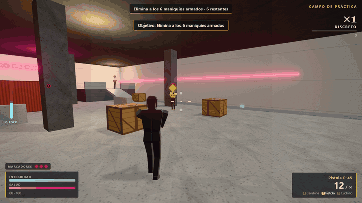
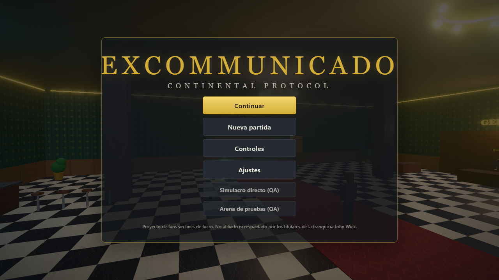
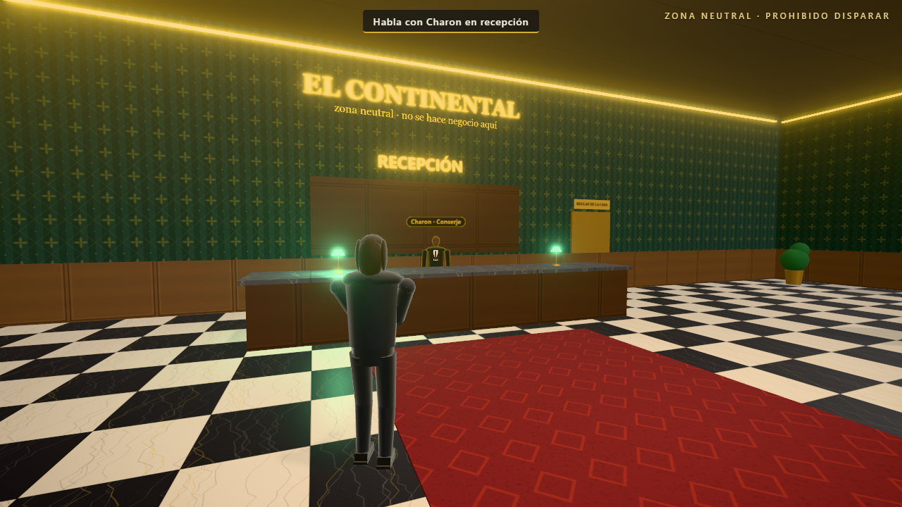
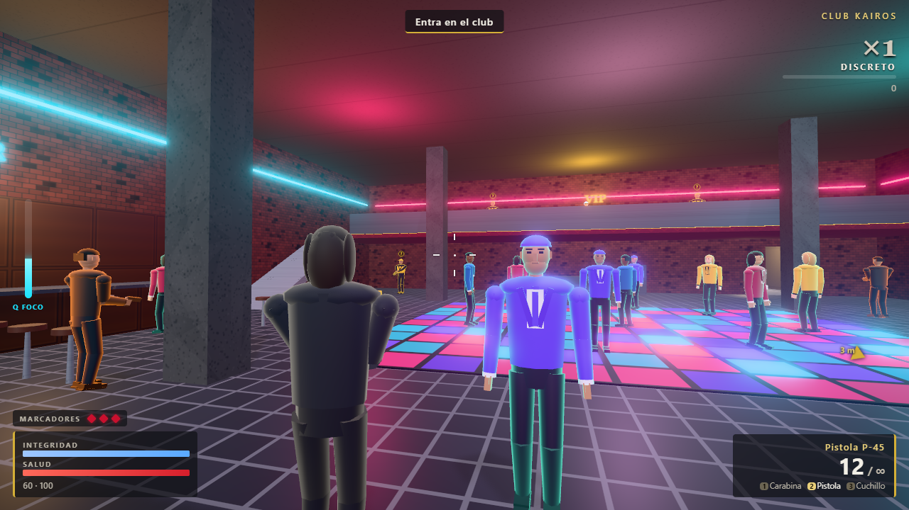
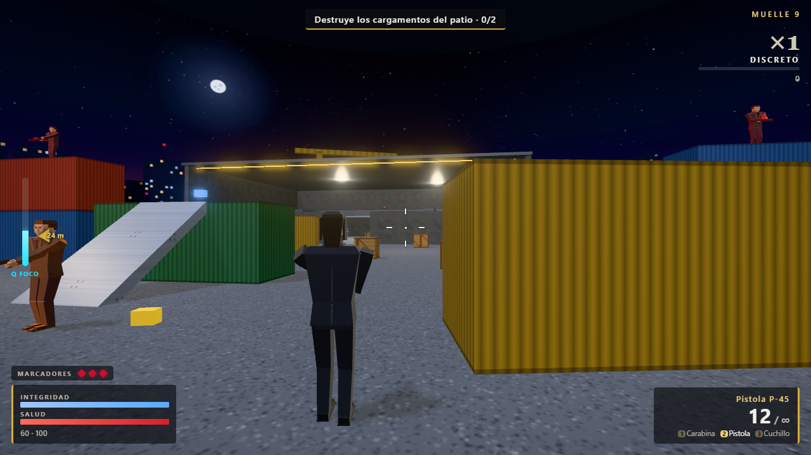
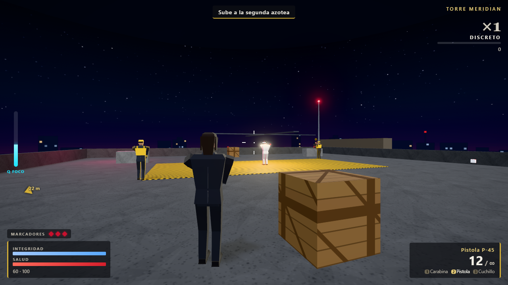
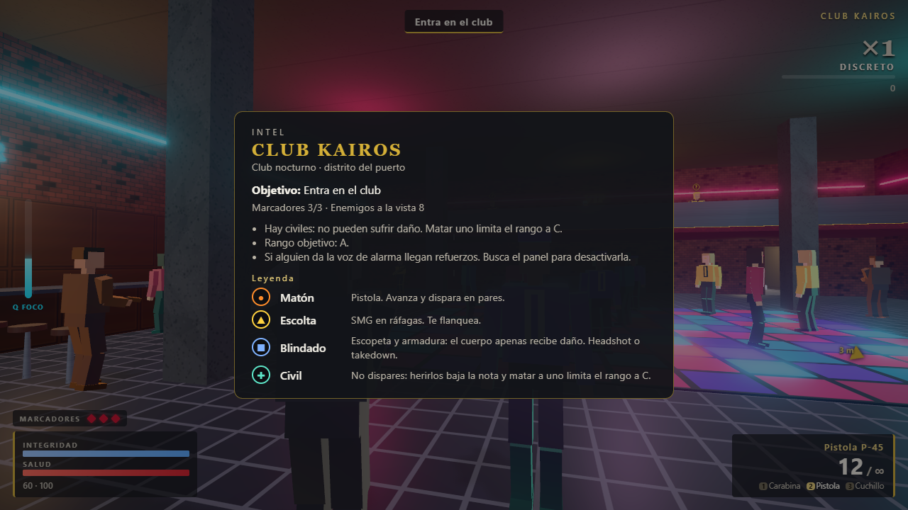

<div align="center">

# EXCOMMUNICADO

### Continental Protocol

Acción en tercera persona para el navegador, inspirada en el universo de John Wick.<br>
Gun-fu, contratos y las reglas del Continental, hecho con TypeScript, Three.js y Rapier.

[](https://github.com/WhySoRichy/excommunicado-continental-protocol/actions/workflows/deploy.yml)


**[Jugar en el navegador](https://whysorichy.github.io/excommunicado-continental-protocol/)**
&nbsp;&middot;&nbsp; [Instalación](INSTALACION.md)
&nbsp;&middot;&nbsp; [Diseño](docs/DISENO.md)
&nbsp;&middot;&nbsp; [Arquitectura](docs/ARQUITECTURA.md)
&nbsp;&middot;&nbsp; [Roadmap](docs/ROADMAP.md)



</div>

---

## El juego

Eres el Huésped, un asesino retirado al que han vuelto a llamar. El hotel Continental es territorio neutral: ahí se habla, se compra y se aceptan contratos, pero no se dispara. Fuera, cada contrato se puntúa por estilo, precisión y economía de movimiento.

| | |
|---|---|
| **El Continental** | Hub con Charon (contratos), el Sommelier (armería) y Winston. Romper la Regla I tiene consecuencias: Excomunicado, multa del 30 % de tus monedas, alarma y tres oleadas que asaltan el hotel |
| **Simulacro de combate** | Tutorial jugable de unos 3 minutos que enseña cada movimiento con la tecla que tengas asignada, y después 6 maniquíes armados |
| **Club Kairos** | Una pista llena de civiles que no hay que tocar, un panel de alarma que conviene desactivar y Vance en el VIP |
| **Muelle 9** | Contenedores apilados con tiradores, tres cargamentos que destruir y la huida en bote |
| **Torre Meridian** | Tres azoteas a distinta altura, el Juez con fases y 45 segundos para escapar |
| **Gauntlet** | Oleadas infinitas en el vestíbulo, una sola vida y un top 10 local |

Cada contrato termina con un **rango de D a S** (tiempo, precisión, daño recibido, variedad y civiles). Los **marcadores de sangre** hacen de vidas, y las monedas se gastan en mejoras: cargador extendido, silenciador, trajes balísticos, escopeta y más. Hay 16 logros.

En combate tienes carabina, pistola, escopeta y cuchillo, takedowns con doble tap, recarga perfecta, **Foco** (cámara lenta), cobertura, vault, deslizamiento y voltereta. El medidor de estilo, de ×1 a ×8, premia variar.

## Capturas

<table>
  <tr>
    <td></td>
    <td></td>
  </tr>
  <tr>
    <td></td>
    <td></td>
  </tr>
  <tr>
    <td></td>
    <td></td>
  </tr>
</table>

## Controles

| Acción | Teclado y ratón | Mando |
|---|---|---|
| Mover / mirar | WASD / ratón | Stick izquierdo / derecho |
| Disparar / apuntar | Clic izquierdo / clic derecho | RT / LT |
| Recargar (otra vez en la zona dorada: recarga perfecta) | R | X |
| Takedown | F | B |
| Interactuar | E | A |
| Saltar y vault | Espacio | A |
| Esquivar (o doble Espacio) | Alt | RB |
| Sprint | Shift | L3 |
| Agacharse, deslizarse, cubrirse | C | Y |
| Foco | Q | LB |
| Armas | 1, 2, 3 o rueda | Cruceta |
| Cambiar de hombro | V | R3 |
| Intel (mantener) | Tab | Select |
| Pausa / controles | Esc / H | Start |

Todo se puede reasignar en **Ajustes → Teclas**, y los avisos en pantalla muestran siempre la tecla real. Ajustes también incluye sensibilidad, invertir Y, apuntar alternando, FOV, brillo, calidad gráfica, volúmenes, sacudida de cámara, tamaño de la interfaz y pistas.

## Ejecutarlo en local

Necesitas [Node.js](https://nodejs.org) 22.12 o superior (se recomienda la 24 LTS).

```bash
git clone https://github.com/WhySoRichy/excommunicado-continental-protocol.git
cd excommunicado-continental-protocol
npm install
npm start
```

El navegador se abre en http://localhost:4173. La guía completa, con instalación de Node.js en Windows, macOS y Linux, descarga en ZIP y solución de problemas, está en **[INSTALACION.md](INSTALACION.md)**.

## Tecnología

- **TypeScript en modo strict** con Vite 8.
- **Animación procedural**, sin clips grabados: las piernas se resuelven con cinemática inversa para que los pies pisen el suelo, y las poses de arma, recarga, deslizamiento o voltereta se calculan en cada frame.
- **Three.js 0.187** para el render: personajes low-poly como un solo `SkinnedMesh`, rim light Fresnel, IBL, sombras y resolución dinámica.
- **Rapier 0.21** para la física: el `KinematicCharacterController` mueve las cápsulas de jugador, enemigos y civiles.
- **Bucle a paso fijo de 60 Hz** con interpolación de render y una sola máquina de estados de juego.
- **Niveles como datos**: mallas y colliders salen de la misma fuente, y la navegación (rejilla 2.5D con A*) se genera a partir de ellos.
- **Audio 100 % Web Audio**: disparos, ambientes, sirena y música adaptativa que sube con el combate. No hay ningún archivo de sonido.
- **Todo el contenido es procedural**: no hay modelos, texturas ni música de terceros.

```
src/
  core/       bucle, entrada, máquina de estados, guardado y ajustes
  physics/    mundo de Rapier y consultas
  entities/   jugador, enemigos (con su IA), civiles, NPC y rig de personajes
  combat/     armas, daño, estilo y rango
  levels/     datos de cada nivel, constructor y navegación
  hub/        reglas del Continental y economía
  missions/   director de misión, tutorial, Gauntlet y logros
  ui/         HUD, menús e Intel
  audio/      motor de audio y música
  render/     renderer, materiales, efectos y resolución dinámica
```

Los detalles, decisiones técnicas y convenciones están en [docs/ARQUITECTURA.md](docs/ARQUITECTURA.md). Para retomar o ampliar el proyecto: [guía de desarrollo](docs/CONTRIBUIR.md) y [roadmap](docs/ROADMAP.md).

## Pruebas y calidad

| | |
|---|---|
| **143 pruebas unitarias** (Vitest) | Cinemática inversa del rig, daño, estilo, rango (incluida una prueba de coherencia con 500 partidas al azar), economía, IA de los enemigos, navegación de cada nivel, guardado, reasignación de teclas, oleadas y música |
| **38 pruebas e2e** (Playwright) | El juego real sobre el build de producción: movimiento sin atravesar paredes ni atascarse (también con picos de lag), combate contra varios enemigos, los cuatro contratos y el Gauntlet de principio a fin, tutorial, ajustes persistentes, mando, claridad visual, mezcla de audio y rendimiento |
| **CI** | Cada push a `main` ejecuta las pruebas y publica el juego en GitHub Pages |

### Rendimiento

Medido en el nivel más pesado (Club Kairos: 12 civiles y 8 enemigos):

| Métrica | Medida | Límite |
|---|---|---|
| Draw calls | 139 | 260 |
| Triángulos | 15 k | 120 k |
| CPU por frame | ~2 ms | 4 ms |
| CPU por frame, CPU frenada ×2 (portátil con gráfica integrada) | 4–7 ms | 10 ms |
| JavaScript del juego / motor de física (gzip) | 240 KB / 1,6 MB | 300 KB / 1,8 MB |

Con una RTX 4060 va a 144 FPS (el tope del monitor). En gráficas integradas el juego arranca en calidad Baja.

## Créditos y licencia

Proyecto de **WhySoRichy** para la asignatura de Programación Avanzada. Bibliotecas y herramientas en [CREDITS.md](CREDITS.md). El código está bajo la [licencia MIT](LICENSE).

> **Proyecto de fans sin ánimo de lucro.** No está afiliado ni respaldado por Lionsgate, 87Eleven ni los titulares de la franquicia John Wick. No usa material con copyright (logos, música, modelos o imágenes) ni el parecido de ningún actor. Los nombres y marcas citados pertenecen a sus dueños.
