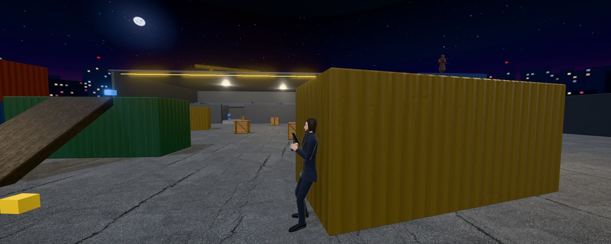
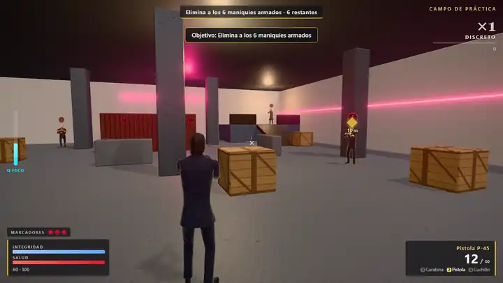
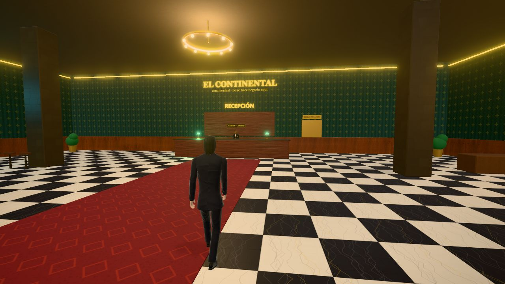
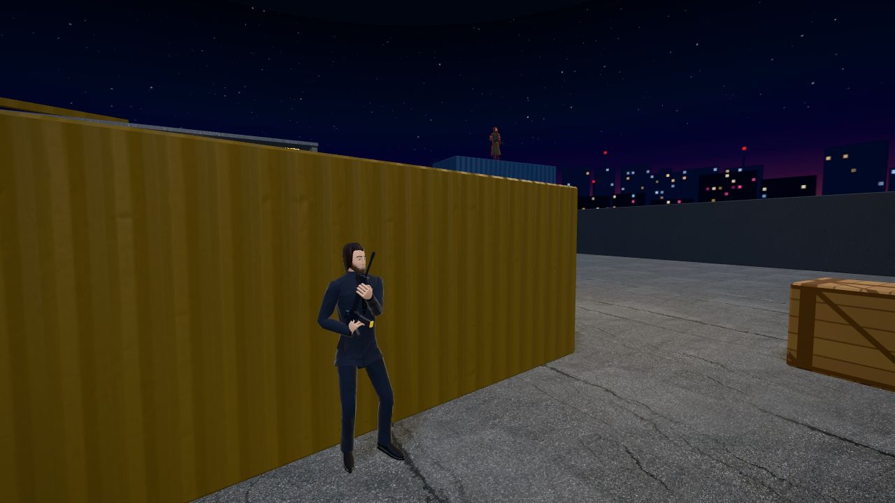
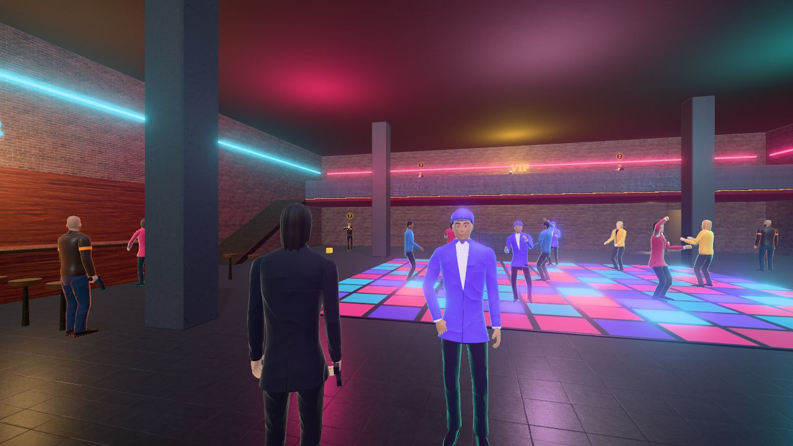
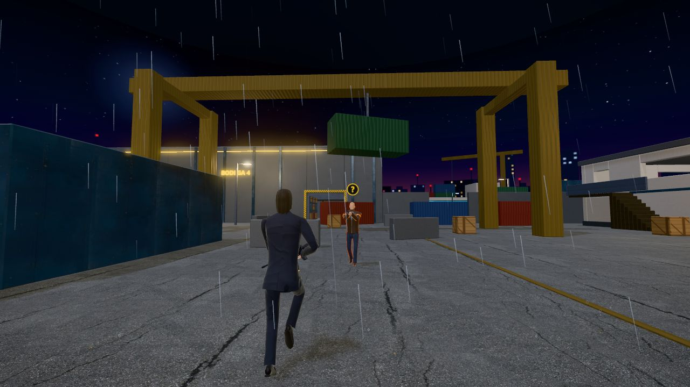
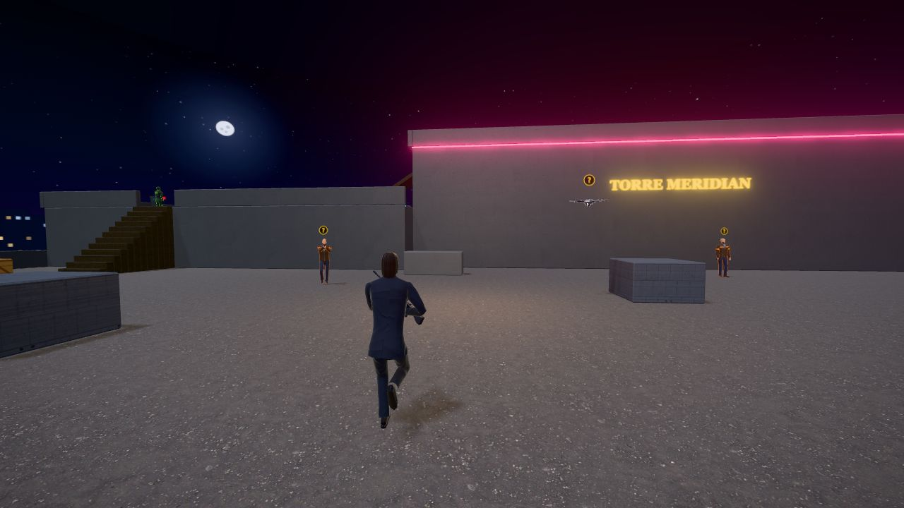
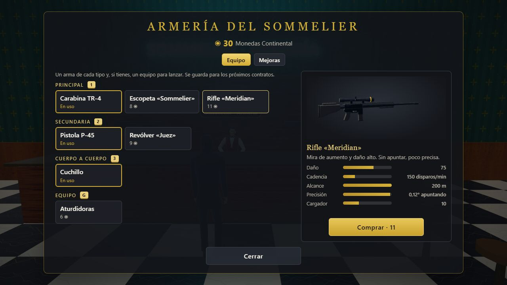

<div align="center">



# EXCOMMUNICADO: CONTINENTAL PROTOCOL

**Acción en tercera persona para el navegador.**<br>
Tiroteos a bocajarro, coberturas, contratos puntuados y un hotel en el que está prohibido disparar.

### [Jugar ahora](https://whysorichy.github.io/excommunicado-continental-protocol/)

Gratis, sin instalar nada y sin cuenta. Solo, o con hasta tres amigos.

[](https://github.com/WhySoRichy/excommunicado-continental-protocol/actions/workflows/deploy.yml)


[](LICENSE)

[El juego](#el-juego) &nbsp;·&nbsp; [Contratos](#contratos) &nbsp;·&nbsp; [Controles](#controles) &nbsp;·&nbsp; [Por dentro](#por-dentro) &nbsp;·&nbsp; [Ponerlo en marcha](#ponerlo-en-marcha) &nbsp;·&nbsp; [Rumbo](#rumbo)

</div>

---

## El juego

Eres el Huésped, un asesino retirado al que han vuelto a llamar. El Continental es terreno neutral: ahí se habla, se compra y se firman contratos. Fuera, cada trabajo se puntúa por tiempo, precisión, variedad y limpieza.

Es un proyecto independiente: los personajes, las armas, la animación, el sonido y la música se generan en el propio juego. No hay modelos ni clips comprados.

<div align="center">

</div>

**Tiroteos de cerca.** Doble tap, recarga perfecta, remates cuerpo a cuerpo y Foco, la cámara lenta que se gana peleando bien. El medidor de estilo, de ×1 a ×8, premia variar.

**Coberturas que se usan de verdad.** Manteniendo una tecla se corre a la que miras. Con la espalda en la pared se recorre, se rodea la esquina, se asoma por el borde o por encima y se dispara a ciegas. También se llega deslizándose o saltando por encima.

**Enemigos que pelean en escuadra.** Se turnan para disparar, avisan cuando te rodean, recargan a cubierto y se apartan de las granadas. Cada impacto se nota donde da. Hay matones, escoltas, tiradores, blindados, antidisturbios con escudo, sabuesos mecánicos, drones y un Juez que no perdona.

**Un inventario con decisiones.** Al contrato llevas cuatro piezas: un arma principal, una secundaria, el cuchillo y el equipo. Se eligen en la armería, donde se ven en 3D, con lo que ganas en cada trabajo.

**Reglas con consecuencias.** Dispara dentro del hotel y quedarás Excomunicado: multa, alarma y tres oleadas que entran a por ti.

## Contratos

| | |
|---|---|
| **Simulacro** | Un tutorial de tres minutos que enseña cada movimiento con tu propia tecla y termina a tiros |
| **Club Kairos** | Una pista llena de civiles que no hay que tocar, una alarma que conviene apagar y Vance arriba, en el VIP |
| **Muelle 9** | Contenedores apilados, tiradores en lo alto, tres cargamentos que destruir y la huida en bote |
| **Torre Meridian** | Tres azoteas, el Juez por fases y 45 segundos para salir |
| **Gauntlet** | Oleadas sin fin en el vestíbulo con una sola vida |

Todos se pueden jugar en **cooperativo, hasta cuatro**: uno abre la sala y los demás entran con su código de cinco letras o desde la lista de salas públicas. Si alguien se corta, vuelve solo a su sitio.

<table>
  <tr>
    <td width="50%"></td>
    <td width="50%"></td>
  </tr>
  <tr>
    <td></td>
    <td></td>
  </tr>
  <tr>
    <td></td>
    <td></td>
  </tr>
</table>

## Controles

| Acción | Teclado y ratón | Mando |
|---|---|---|
| Moverse / mirar | WASD / ratón | Sticks |
| Disparar / apuntar | Clic izquierdo / derecho | RT / LT |
| Recargar (otra vez en la zona dorada: perfecta) | R | X |
| Remate cuerpo a cuerpo | F | B |
| Interactuar | E | A |
| Saltar, pasar por encima | Espacio | A |
| Esquivar | Alt o doble Espacio | RB |
| Esprintar | Shift | L3 |
| Agacharse, deslizarse, cubrirse (mantener: correr a cubierto) | C | Y |
| Lanzar el equipo (mantener: ver el arco) | G | Cruceta izquierda |
| Foco | Q | LB |
| Armas | 1, 2, 3 o rueda | Cruceta arriba, derecha y abajo |
| Cambiar de hombro | V | R3 |
| Intel | Tab | Select |
| Pausa / controles | Esc / H | Start |

Todo se reasigna en **Ajustes → Teclas**, y los avisos en pantalla muestran siempre la tecla que hayas puesto. Hay además sensibilidad, apuntar alternando, campo de visión, brillo, calidad gráfica, volúmenes por canal, sacudida de cámara y tamaño de la interfaz.

## Por dentro

TypeScript en modo estricto, [Three.js](https://threejs.org) para dibujar, [Rapier](https://rapier.rs) para la física y [Vite](https://vite.dev) para construir. Nada más en tiempo de ejecución.

**Personajes generados por código.** Cada cuerpo, con sus manos, su cara, su pelo y su ropa, es una sola malla con esqueleto de 24 huesos que se construye al cargar, en dos niveles de detalle. Cada tipo de enemigo se reconoce por la silueta.

**Animación por capas, sin clips grabados.** Un ciclo de marcha que no patina (el pie apoyado retrocede justo a la velocidad a la que avanza el cuerpo), cinemática inversa en brazos y piernas, y el arma manda: se coloca el arma y las manos van a ella. La postura depende de lo que pasa: relajado, en guardia, encarando, de espaldas a una pared, herido, aturdido. Las transiciones van con muelles y se miden articulación por articulación.

**La simulación no sabe que existe la pantalla.** Corre a paso fijo de 60 Hz y se puede ejecutar entera en Node: los contratos se prueban jugándolos sin dibujar nada. Lo que se ve la lee y nunca la cambia.

**Cooperativo con autoridad del anfitrión.** Los disparos se predicen con la misma semilla que usará el anfitrión y se resuelven contra lo que cada uno tenía en pantalla (compensación de latencia). Va por WebRTC, con un servicio de salas propio en el plan gratuito de Cloudflare.

**Escenarios como datos.** De una misma descripción salen la malla, las colisiones y la navegación. Texturas fotoescaneadas con relieve, aristas biseladas, luz basada en imagen, oclusión ambiental y resolución dinámica.

**Sonido y música sintetizados.** Ni un archivo de audio: disparos, ambientes y una banda sonora que sube con el combate, hechos con Web Audio.

```
src/
  core/       bucle, entrada, máquina de estados, guardado y ajustes
  physics/    mundo físico y consultas
  entities/   jugador, enemigos y su IA, civiles, gente del hotel y cuerpo de todos ellos
  combat/     armas, daño, granadas, estilo y rango
  net/        cooperativo: protocolo, anfitrión, invitado y transportes
  levels/     datos de cada nivel, constructor y navegación
  missions/   contratos, tutorial, Gauntlet y logros
  hub/        reglas del Continental y economía
  render/     materiales, efectos y resolución dinámica
  audio/      motor de sonido y música
  ui/  text/  interfaz y textos
server/       servicio de salas
```

Más en profundidad: [arquitectura](docs/ARQUITECTURA.md), [diseño](docs/DISENO.md), [escalabilidad](docs/ESCALABILIDAD.md) y [guía de desarrollo](docs/CONTRIBUIR.md).

### Pruebas

| | |
|---|---|
| **394 unitarias** | Partidas completas sin pantalla, red con latencia y pérdidas, IA de cada enemigo y de la escuadra, balística, cobertura, animación (marcha sin patinar, manos en el arma, posturas), mallas, niveles, economía y guardado |
| **66 de navegador** | El juego construido como en producción: contratos de principio a fin, cooperativo entre dos pestañas, movimiento sin atravesar paredes, tirones de animación, rendimiento, fugas de memoria, claridad visual, audio, mando y ajustes |

Cada cambio pasa por el linter, la auditoría de dependencias y las dos baterías antes de publicarse.

### Rendimiento

Peor valor de todos los niveles en calidad Alta, comprobado en cada cambio:

| | Medido | Tope |
|---|---|---|
| Llamadas de dibujo | 146 | 260 |
| Triángulos, con sombras | 176 k | 230 k |
| CPU por fotograma | 2,2 ms | 4 ms |
| CPU por fotograma con el procesador frenado a la mitad | 5,8 ms | 10 ms |
| Descarga del juego / de la física (gzip) | 353 KB / 1,6 MB | 355 KB / 1,8 MB |

En una RTX 4060 va a 144 FPS, el tope del monitor. En gráficas integradas arranca en calidad Baja.

## Ponerlo en marcha

Hace falta [Node.js](https://nodejs.org) 22.12 o superior.

```bash
git clone https://github.com/WhySoRichy/excommunicado-continental-protocol.git
cd excommunicado-continental-protocol
npm install
npm start
```

Se abre en http://localhost:4173. Paso a paso, para cualquier sistema y con los problemas habituales: [INSTALACION.md](INSTALACION.md).

| Para desarrollar | |
|---|---|
| `npm run dev` | Servidor con recarga |
| `npm test` / `npm run test:e2e` | Pruebas unitarias / de navegador |
| `npm run lint` | Linter, formato y código sin uso |
| `npm run sheets` | Láminas de personajes, posturas, marcha, armas y golpes con el motor del juego |

## Rumbo

Lo que el juego promete a quien lo juega está en [VISION.md](docs/VISION.md): **gratis, sin pagar por ventaja** y con todo lo cosmético al alcance de quien juega. Lo siguiente, en orden:

1. Mapas más grandes, con rutas para rodear y alturas.
2. Acabados de armas y accesorios que solo se ven.
3. Universo propio e idioma inglés.
4. Arena PvP en salas privadas.

El detalle, con su estado, en el [roadmap](docs/ROADMAP.md).

## Licencia y créditos

Proyecto independiente de **WhySoRichy**, inspirado en el universo de John Wick. Código bajo [licencia MIT](LICENSE). Texturas CC0, bibliotecas y herramientas en [CREDITOS.md](docs/CREDITOS.md).
